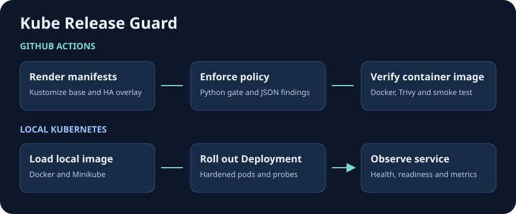

# Kube Release Guard

[](https://github.com/nikhil-official358/kube-release-guard/actions/workflows/ci.yml)

Kube Release Guard checks Kubernetes Deployment manifests in CI and demonstrates a hardened rollout with a small Python HTTP service. It brings together Kubernetes, Docker, GitHub Actions, container vulnerability scanning, dependency updates, and Prometheus-compatible metrics.



## Jenkins troubleshooting

The [Jenkins Troubleshooting Agent](jenkins-agent/) reads build logs and provides evidence-based diagnosis with optional local Ollama advice.

## Cloud capacity triage

[Docker Capacity Pilot](cloud-capacity-copilot/) compares live Kubernetes resource usage with container requests and offers optional local AI advice.

## What the gate checks

| Area | Release checks |
| --- | --- |
| Pod identity | Non-root UID, RuntimeDefault seccomp, and service account token automount disabled |
| Container isolation | Read-only root filesystem, privilege escalation disabled, and all Linux capabilities dropped |
| Reliability | CPU and memory requests and limits, plus readiness and liveness probes |
| Image integrity | Optional SHA-256 digest requirement for registry-backed deployments |
| CI image scan | Trivy fails the build on fixable high or critical image vulnerabilities |

The CLI emits JSON and exits with **0** for a pass, **1** for policy findings, or **2** for malformed manifest data. It checks rendered Deployment documents and works without cluster credentials.

## Run the release checks

Requires Python 3.12 and the Kubernetes CLI. Run from the repository root.

```sh
python -m pip install -r requirements.txt
python -m unittest discover -s tests -v
kubectl kustomize k8s/base | python gate.py
kubectl kustomize k8s/overlays/ha | python gate.py
```

To see the image-integrity gate fail, run the same check with the local image tag and enable digest enforcement:

```sh
kubectl kustomize k8s/base | python gate.py --require-digest
```

The expected finding is `pinned-image-digest`. For a registry-backed rollout, update the Kustomize image reference with the published digest before applying this check.

## Deploy to Minikube

Requires a running Docker engine and Minikube. Use a local cluster context.

```sh
minikube start --driver=docker
docker build --build-arg APP_VERSION=local -t release-demo:local .
minikube image load release-demo:local
kubectl --context minikube apply -k k8s/base
kubectl --context minikube rollout status deployment/release-demo --timeout=120s
kubectl --context minikube port-forward service/release-demo 8080:8080
```

In a second terminal:

```sh
curl http://localhost:8080/
curl http://localhost:8080/readyz
curl http://localhost:8080/metrics
```

To test the three-replica overlay, apply `k8s/overlays/ha` instead of the base. It adds a PodDisruptionBudget and prefers spreading replicas across nodes. A multi-node cluster is required to demonstrate node-level resilience.

## Troubleshoot a rollout

| Signal | First check |
| --- | --- |
| `ErrImagePull` | Run `minikube image ls` and confirm the tag matches the rendered Deployment. |
| Pod starts but stays unready | Run `kubectl --context minikube describe pod -l app=release-demo` and inspect probe events. |
| Gate returns exit 1 | Use each finding's `target` and `rule` to locate the failed check. |
| Image scan fails | Review the vulnerable package and the fixed version in the CI scan output. |

Remove the resources with `kubectl --context minikube delete -k k8s/base`. Use the overlay path instead if you deployed that overlay.

## Design boundaries

CI builds and scans the demo image and smoke-tests its HTTP endpoints. Cluster deployment is a local demo. The digest check is optional for that workflow because the demo uses a locally built image tag. The metrics endpoint can be scraped by Prometheus. Prometheus, Grafana, and cloud infrastructure are outside the repository.

The Kubernetes manifests can be adapted to EKS or GKE by replacing the image reference and configuring registry access. Registry publishing, image signing, and GitOps reconciliation are future extensions.
