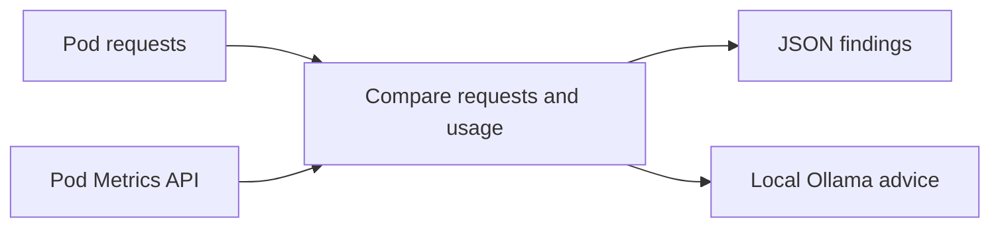

# Cloud Capacity Copilot

Read-only Kubernetes capacity triage for platform engineering and FinOps. Compare live container usage with resource requests, identify missing requests, and use a local model to suggest follow-up checks.

## Run the demo

Requires Python 3.10+. Open PowerShell in this folder.

```powershell
python agent.py --demo
```

The fixture returns low CPU usage and a missing memory request. Its output is labeled DEMO_FIXTURE.

## Read live data

Requires kubectl, an existing cluster and context, and read/list access to Pods and PodMetrics in the chosen namespace. Minikube works for a local lab. GKE, EKS and AKS work through an existing kubeconfig. The agent makes read-only requests. Existing managed clusters may incur their usual charges.

```powershell
kubectl config get-contexts -o name
python agent.py --context minikube --namespace default --watch 15
```

Use Ctrl+C to stop. The Metrics API must be available for usage comparisons. If it is unavailable, the report still checks requests and explicitly marks the metrics unavailable.

## Local AI

Install and run Ollama, then download a local model.

```powershell
ollama pull qwen2.5:1.5b
python agent.py --demo --ollama qwen2.5:1.5b
```

Use the same flag with live mode. The model receives aggregate counts only and runs through a loopback endpoint. Rule-based analysis works without Ollama.

## Interpret findings

CPU and memory are compared independently. Samples at or below 25% of a request or at or above 90% are review signals. Requests are scheduling inputs. Usage above a request alone does not imply throttling or an outage. Samples older than 120 seconds are excluded. Collect representative history and check workload peaks, autoscaling and service objectives before changing requests.


