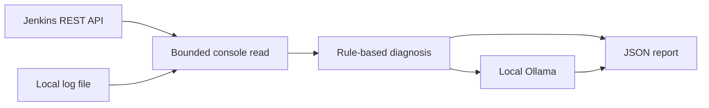

# Jenkins Troubleshooting Agent

A read-only Jenkins diagnostic CLI with live polling, evidence line numbers, and optional local AI advice.



## Quick demo

Requires Python 3.10 or newer. Run from this directory. The agent uses the Python standard library.

```powershell
python -m unittest -v
python agent.py --log examples/failed-build.log
```

The fixture returns a `docker_daemon` finding and references the matching console line.

## Monitor a live Jenkins build

Use a Jenkins account with read access to the target job and its console. Provide its token through the environment in your current terminal, using a masked prompt.

```powershell
$env:JENKINS_URL = 'https://jenkins.example.com'
$env:JENKINS_USER = 'jenkins-reader'
$env:JENKINS_API_TOKEN = Read-Host 'Jenkins API token' -MaskInput
python agent.py --job 'Platform/Container Build' --build lastBuild --watch 10
```

Omit `--watch` for a single read. Use `--build 42` for an exact build or `--build lastFailedBuild` for a recent failure. For a local Jenkins controller use `http://127.0.0.1:8080`. Ctrl+C ends polling. Watch mode emits a JSON line when the build metadata or observed log changes.

## Enable free local AI

Install [Ollama](https://ollama.com/download), start it locally, and download the model once. Local inference uses your machine and has no per-request API charge. The model download requires internet access. Configure Ollama for local-only operation using its [FAQ](https://docs.ollama.com/faq).

```powershell
ollama pull qwen2.5:1.5b
python agent.py --log examples/failed-build.log --ollama qwen2.5:1.5b
python agent.py --job 'Platform/Container Build' --build lastFailedBuild --ollama qwen2.5:1.5b
```

The model receives only known diagnostic category IDs and a normalized build result. Raw console lines and Jenkins credentials stay outside the prompt. If Ollama is unavailable, the JSON report still contains rule-based findings.

## Scope and evidence

The agent reads build metadata and up to the first 256 KiB of its console. A truncated report can miss later errors. Findings cite 1-based line numbers and suggest actions for an operator to review. The agent performs no Jenkins writes, shell execution from log text, or automated remediations. It covers common SCM, agent, Docker, registry, storage, memory, test, Jenkinsfile, toolchain, TLS, and dependency errors.
